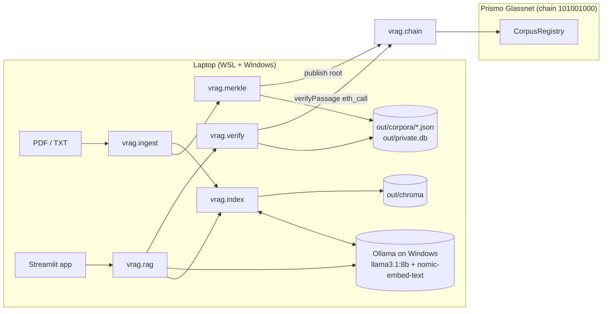
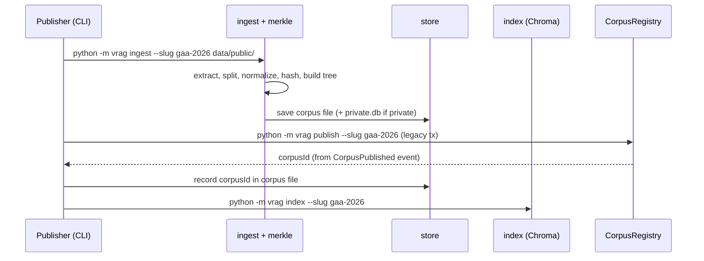
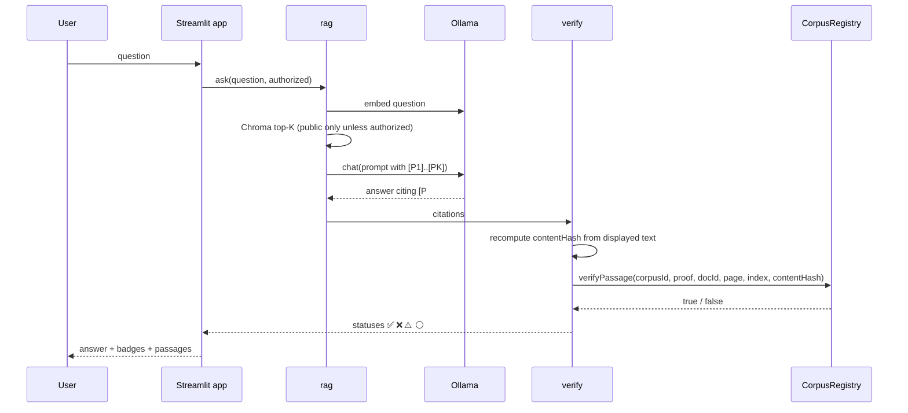

# Design Document

## Overview

The system has two phases:

1. **Publish (once per corpus version):** documents → passages → content hashes → Merkle tree →
   root published to `CorpusRegistry` on Prismo Glassnet. Passages are also embedded and indexed
   in Chroma for search.
2. **Ask (every question):** question → search → LLM answer with `[P#]` labels → each citation is
   re-hashed from its displayed text and checked on-chain with its Merkle proof → UI shows status.

Only roots and metadata go on-chain. Passage text, embeddings, salts, and trees stay local.

## Architecture



### Publish sequence



### Ask sequence



## Components and Interfaces

### `vrag/config.py`
Loads `.env` with python-dotenv into a frozen dataclass.

| Variable | Default | Notes |
|---|---|---|
| `NETWORK` | `local` | `local` or `glassnet` |
| `RPC_URL` | `http://127.0.0.1:8545` | Glassnet: `https://rpc.glassnet.prismo.network` |
| `REGISTRY_ADDRESS` | (required for publish/verify) | Deployed CorpusRegistry |
| `PRIVATE_KEY` | (required for publish only) | Testnet-only wallet |
| `OLLAMA_URL` | `http://localhost:11434` | Ollama on Windows |
| `OLLAMA_MODEL` | `llama3.1:8b` | |
| `OLLAMA_EMBED_MODEL` | `nomic-embed-text` | |
| `TOP_K` | `5` | |
| `MIN_SIMILARITY` | `0.35` | Cosine similarity cut-off; tune on real data |
| `AUDITOR_TOKEN` | (empty = private features disabled) | |
| `EXPLORER_URL` | `https://explorer.glassnet.prismo.network` | |

`EXPECTED_CHAIN_IDS = {"local": 31337, "glassnet": 101001000}`.

### `vrag/text.py`
- `normalize(text: str) -> str` — NFC, collapse whitespace, strip.
- `content_hash(text: str, salt: bytes = ZERO32) -> bytes` —
  `keccak(abi_encode(["bytes32", "string"], [salt, normalize(text)]))`.

### `vrag/merkle.py`
- `leaf_hash(doc_id: str, page: int, index: int, content_hash: bytes) -> bytes` —
  `keccak(keccak(abi_encode(["string","uint32","uint32","bytes32"], [...])))`.
- `hash_pair(a, b) -> bytes` — `keccak(min(a,b) + max(a,b))`.
- `build_tree(leaves: list[bytes]) -> list[list[bytes]]` — levels from leaves to root, leaves
  kept in passage order; an odd last node is promoted unchanged.
- `root(levels) -> bytes`, `proof(levels, leaf_index) -> list[bytes]`,
  `verify(proof, root, leaf) -> bool` (mirror of OpenZeppelin, used in tests).
- Empty corpus is an error. A single-leaf tree has `root == leaf` and an empty proof.

### `vrag/ingest.py`
- `extract_pages(path) -> list[str]` — PyMuPDF for PDF (`page.get_text()`), whole file as page 1 for TXT.
- `split_passages(page_text) -> list[str]` — split on blank lines, then merge short paragraphs and
  split long ones on sentence boundaries to stay within 300–1,200 characters.
- `ingest_folder(folder, slug, name, version, private) -> Corpus` — deterministic: files sorted by
  name, passages in reading order.

### `vrag/store.py`
- Public corpus file `out/corpora/<slug>.json`:
  ```json
  {
    "slug": "gaa-2026", "name": "GAA 2026", "version": "v1", "private": false,
    "corpusId": 0, "root": "0x…", "registry": "0x…", "chainId": 101001000,
    "passages": [
      {"docId": "gaa-2026-vol1", "page": 12, "index": 0,
       "text": "…", "contentHash": "0x…", "leafIndex": 0}
    ],
    "levels": [["0x…", "…"], ["…"], ["0x<root>"]]
  }
  ```
- Private corpora use the same file layout but `text` is omitted and `salt` is never present.
  Text and salt live in `out/private.db`:
  `passages(slug TEXT, doc_id TEXT, page INT, idx INT, text TEXT, salt BLOB, PRIMARY KEY(slug, doc_id, page, idx))`.
- `load_corpus(slug)`, `get_passage(slug, doc_id, page, index, authorized) -> Passage | None`.

### `vrag/index.py`
- `embed(texts) -> list[list[float]]` via Ollama `/api/embed`.
- One Chroma collection `passages` in `out/chroma`, cosine distance, IDs
  `<slug>:<docId>:p<page>:<index>`, metadata `{slug, private, docId, page, index}`.
- Private passages are indexed (the index is local, server-side) but filtered out with
  `where={"private": False}` for unauthorized searches.
- `search(question, k, authorized) -> list[(passage_ref, similarity)]`.

### `vrag/chain.py`
- `connect(config) -> Web3` — checks `w3.eth.chain_id` against `EXPECTED_CHAIN_IDS[NETWORK]`,
  raises `WrongChainError` on mismatch.
- `publish(corpus) -> int` — builds a legacy tx with `gasPrice = w3.eth.gas_price`, estimates gas,
  signs with `PRIVATE_KEY`, waits for the receipt, reads `corpusId` from `CorpusPublished`.
- `verify_passage(corpus_id, proof, doc_id, page, index, content_hash) -> bool` — `eth_call`.
- `get_corpus(corpus_id)`.
- ABI loaded from `contracts/out/CorpusRegistry.sol/CorpusRegistry.json` (Foundry build output).

### `vrag/rag.py`
- `ask(question, authorized) -> Answer` — search; if best similarity < `MIN_SIMILARITY`, return a
  "not found in the documents" answer with no LLM call. Otherwise build the prompt, call Ollama
  `/api/chat` with `temperature=0`, parse labels with regex `\[P(\d+)\]`.
- Prompt rules: answer only from the passages; cite `[P#]` after each claim; put exact quotes in
  double quotes; say "The documents do not say" when unsure.
- `Answer = {text, citations: [Citation], passages: {label: PassageRef}}`.

### `vrag/verify.py`
- `check_citation(label, answer, passages, displayed_text, authorized) -> CitationResult`
  1. Label not in `passages` → ❌ Unknown source.
  2. Recompute `content_hash(displayed_text, salt)` (salt from private.db for private passages,
     zero for public). Recompute the leaf with `merkle.leaf_hash`.
  3. Get the proof from the stored levels using `leafIndex`.
  4. `chain.verify_passage(...)` → ✅ / ❌. Network error → ⚪ Unable to verify.
  5. Quote check: every `"…"` that is followed by this label must be a substring of
     `normalize(displayed_text)`; otherwise add ⚠️ Quote not found.
- `make_receipt(citation) -> dict` and `verify_receipt(receipt) -> ReceiptResult`.
  Receipt JSON: `{corpusId, docId, page, index, contentHash, proof, registry, chainId}`.
  `verify_receipt` refuses receipts whose `chainId` or `registry` differ from the config.

### `vrag/cli.py` (`python -m vrag …`)
| Command | Purpose |
|---|---|
| `ingest <folder> --slug --name --version [--private]` | Build corpus file (+ private.db) |
| `publish --slug` | Publish root, save corpusId |
| `index --slug` | Embed and add to Chroma |
| `ask "<question>" [--auditor]` | Ask from the terminal, print statuses |
| `verify-receipt <file.json>` | Check a receipt |
| `fixtures` | Write `contracts/test/fixtures/merkle.json` |
| `check` | Print network, chain ID, registry, Ollama status |

### `app/streamlit_app.py`
- Sidebar: network + chain ID, registry link to explorer, auditor token field, tamper demo toggle,
  receipt verifier (paste JSON).
- Main: chat input, answer, citation list with badges; expander per citation with passage text,
  passage ID, corpus name/version, "Export receipt" button (authorized + private only).
- Tamper toggle replaces the first digit (or first character) of the displayed passage before
  verification and labels the passage "(modified for demo)".

### `contracts/src/CorpusRegistry.sol`

```solidity
// SPDX-License-Identifier: MIT
pragma solidity 0.8.24;

import {Ownable} from "@openzeppelin/contracts/access/Ownable.sol";
import {MerkleProof} from "@openzeppelin/contracts/utils/cryptography/MerkleProof.sol";

contract CorpusRegistry is Ownable {
    struct Corpus {
        bytes32 root;
        string name;
        string version;
        bool isPrivate;
        uint32 passageCount;
        uint64 publishedAt;
    }

    Corpus[] private _corpora;

    event CorpusPublished(uint256 indexed corpusId, bytes32 root, string name, string version, bool isPrivate);

    constructor(address initialOwner) Ownable(initialOwner) {}

    function publish(bytes32 root, string calldata name, string calldata version, bool isPrivate, uint32 passageCount)
        external onlyOwner returns (uint256 corpusId);           // require root != 0, passageCount > 0

    function corpusCount() external view returns (uint256);
    function getCorpus(uint256 corpusId) external view returns (Corpus memory);

    function leafOf(string calldata docId, uint32 page, uint32 index, bytes32 contentHash)
        public pure returns (bytes32);                           // double keccak of abi.encode

    function verifyPassage(uint256 corpusId, bytes32[] calldata proof, string calldata docId,
        uint32 page, uint32 index, bytes32 contentHash) external view returns (bool);
        // false if corpusId >= length; else MerkleProof.verifyCalldata(proof, root, leafOf(...))
}
```

`foundry.toml`: `solc = "0.8.24"`, `evm_version = "shanghai"`, `remappings` for OpenZeppelin,
`fs_permissions = [{ access = "read", path = "./test/fixtures" }]`, and an `rpc_endpoints`
entry `glassnet = "https://rpc.glassnet.prismo.network"`.

Deploy: `forge script script/Deploy.s.sol --rpc-url glassnet --broadcast --legacy`
(deployer key from `.env` or a `cast wallet` keystore).

## Data Models

```python
@dataclass(frozen=True)
class Passage:
    slug: str; doc_id: str; page: int; index: int
    text: str | None        # None for private passages in unauthorized sessions
    content_hash: bytes; leaf_index: int; private: bool

@dataclass
class CitationResult:
    label: str; passage: Passage | None
    status: Literal["verified", "not_verified", "unknown_source", "unable"]
    quote_warnings: list[str]
```

## Error Handling

| Situation | Behavior |
|---|---|
| Wrong chain ID | Stop at startup with expected vs actual chain ID |
| RPC unreachable during verify | ⚪ Unable to verify (never ✅) |
| Ollama unreachable / model missing | Error naming `OLLAMA_URL` and the `ollama pull` command |
| Corpus not published yet (`corpusId` missing) | Skip it in search and warn |
| Unreadable PDF | Skip file, list it at the end of ingest |
| Publish tx fails / insufficient USDC | Show the error and the faucet URL |
| Receipt for another chain/registry | Reject with a clear reason |

## Testing Strategy

- **Cross-language Merkle test (critical):** `python -m vrag fixtures` writes sample passages,
  content hashes, leaves, root, and proofs to `contracts/test/fixtures/merkle.json`. A Foundry
  test publishes the root and asserts every proof verifies, and that a changed leaf, changed
  proof element, or wrong corpus ID fails.
- **Python unit tests:** normalization, content hash with/without salt, tree with 1, 2, 3, and
  many leaves, proof round-trips, deterministic ingest of `data/samples/`, citation parsing,
  quote check, receipt rejection for wrong chain.
- **Contract tests:** owner-only publish, event fields, immutability (no setter), unknown ID returns false.
- **Manual end-to-end on Glassnet:** the four demo cases in Requirement 9.4.
